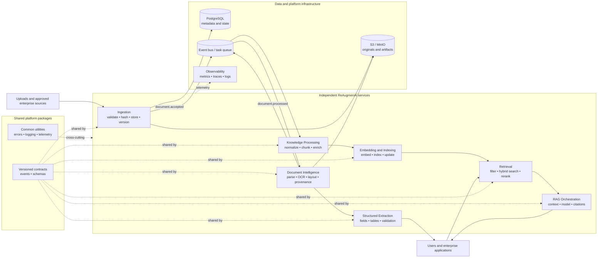
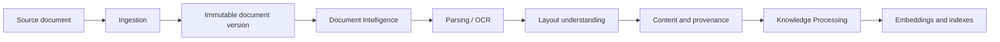
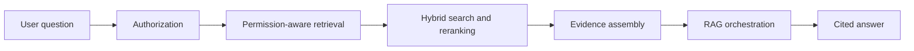
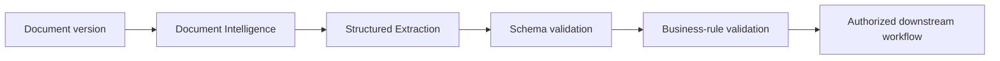

# Architecture

ReAugmenAI is organized around document-version ownership, independently deployable
services, and explicit versioned contracts.

## Platform architecture

## Document preparation flow

## Question-answering flow

## Structured extraction flow

Original documents remain authoritative. Every derived chunk, embedding, evidence item,
and extracted value must retain tenant, document-version, processing-run, and provenance
identifiers. Security, logging, telemetry, retries, and versioned contracts apply across
all services.
